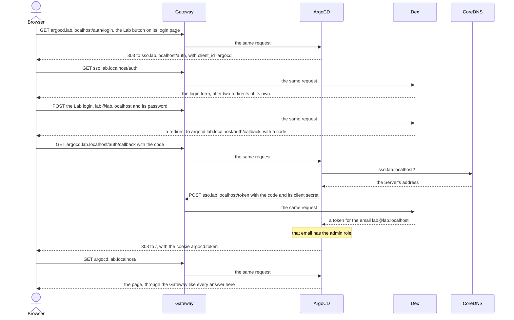
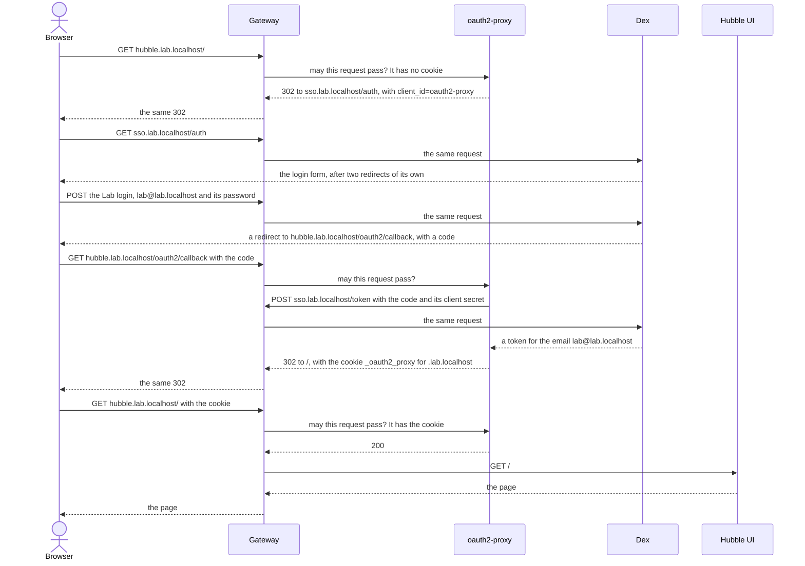

# Logging in

One login, the **Lab login**, opens ArgoCD, Grafana, the Rollouts dashboard and Hubble UI ([ADR 0013](adr/0013-single-sign-on-is-a-standalone-dex-with-the-lab-login-in-the-secret-store.md)). It's `lab@lab.localhost`, with a password that `just host setup` generated once into the Secret Store, so it's the same in every Lab. `just creds` prints it.

[Dex](https://dexidp.io) (`platform/dex/`) signs it in, at https://sso.lab.localhost. Its config is in Git with no secret in it, and ESO gives it the password's hash and each client's secret from the Secret Store. It runs as two instances, which share their signing keys, the logins in progress and their sessions as custom resources in the namespace `sso`: a sign-in's requests can each reach either one. Those go with the Lab.

You type it once. Dex remembers the browser for a day, with its cookie `dex_session`, and answers every other UI's login without showing its form: ArgoCD's and Grafana's "Lab" buttons, and the first request to the Rollouts dashboard or Hubble UI, go there and back by themselves. Dex's form has "remember me" ticked: untick it, and the cookie goes when the browser closes, though the UIs you had opened stay signed in. This is Dex's auth sessions, experimental in 2.46. A restart of Dex keeps them.

A UI uses Dex in one of two ways:

- **ArgoCD and Grafana speak OIDC themselves.** Each has a "Lab" button on its login page, and gives the Lab login its admin role. Each one's own admin login stays, as its **Break-glass login**, new with every Lab, for when Dex is down: `just creds` prints those too. Grafana still lets anyone look without logging in.
- **The Rollouts dashboard and Hubble UI have no login of their own**, so the Gateway asks [oauth2-proxy](https://oauth2-proxy.github.io/oauth2-proxy/) (`platform/oauth2-proxy/`) about every request to them, through an `ExternalAuth` filter on their HTTPRoutes. Its cookie is for `.lab.localhost`, so one sign-in opens both. They have no Break-glass login.

ComfyUI has no login.

**A UI that speaks OIDC itself**, here ArgoCD. The UI trades the code for a token with Dex directly, from its pod, under the same name the browser used. There `sso.lab.localhost` resolves to the Server, where the Gateway listens, not to loopback: CoreDNS says so (`platform/coredns-custom/`).



**A UI behind oauth2-proxy**, here Hubble UI. The Gateway asks oauth2-proxy about every request, the callback included, and passes on to the browser whatever it answers except a 200. oauth2-proxy never carries the UI's traffic: once it says 200, the Gateway sends the request to the UI's own Service.



oauth2-proxy finds Dex as ArgoCD does, through CoreDNS and the Gateway. The cookie is for every name under `lab.localhost`, so the Rollouts dashboard's first request already passes the check.

Both diagrams show a browser that Dex doesn't know yet. For one it remembers, Dex answers `GET sso.lab.localhost/auth` with the redirect to the callback straight away, and the form and the POST drop out.

**When Dex or oauth2-proxy is down**, ArgoCD and Grafana still open with their Break-glass logins. The Rollouts dashboard and Hubble UI answer 403 at their addresses, since the Gateway's check fails closed. A port-forward to a UI's Service reaches it, as it never passes the Gateway:

```sh
kubectl --context k3d-lab -n kube-system port-forward svc/hubble-ui 8080:80
kubectl --context k3d-lab -n argo-rollouts port-forward svc/argo-rollouts-dashboard 3100:3100
```

Hubble UI is then at http://localhost:8080, and the Rollouts dashboard at http://localhost:3100/rollouts/. That's no Break-glass login, and no way around the Lab login: whoever can port-forward can already change the Lab with `kubectl`.
